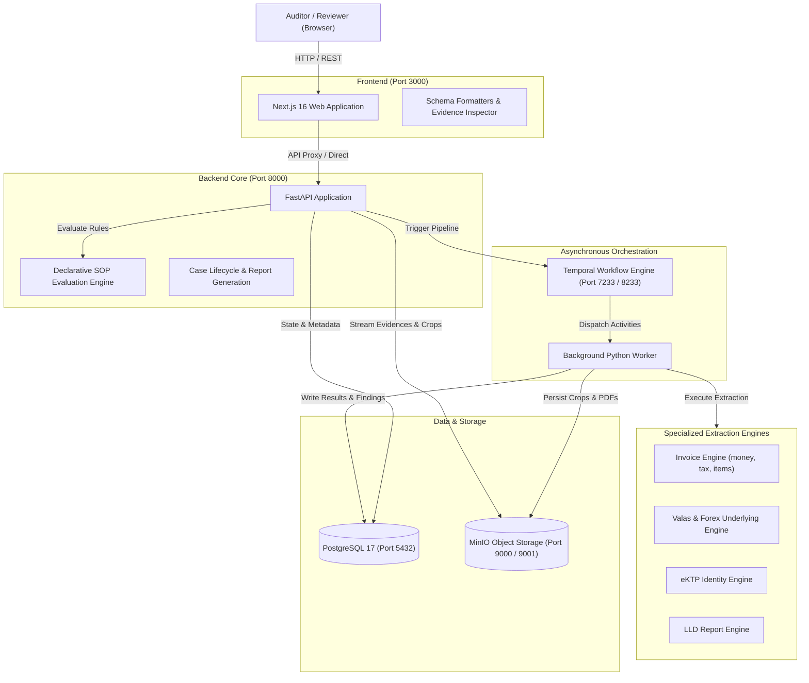

# Document Intelligence Platform

Autonomous document processing, extraction, and SOP compliance auditing platform for trade finance, foreign exchange (Forex/Valas), and commercial underlying documents.

---

## Architecture Overview



---

## Services & Ports

| Service | Port | Description |
| :--- | :--- | :--- |
| **Web UI** | `3000` | Next.js frontend workspace for case reviews and audits |
| **API** | `8000` | FastAPI core service (OpenAPI documentation at `/docs`) |
| **MinIO Storage** | `9000` (API), `9001` (Console) | S3-compatible document and crop storage |
| **Temporal UI** | `8233` | Temporal workflow orchestration dashboard |
| **PostgreSQL** | `5432` | Relational store for cases, documents, reports, and rules |

---

## Quick Start

### Prerequisites
- [Docker Desktop](https://www.docker.com/products/docker-desktop/) (Windows / macOS / Linux)

### Run the Application Stack
Clone the repository and launch all services with Docker Compose:

```bash
# Start all services in the background
docker compose up -d

# View service status
docker compose ps
```

Once running, access the interfaces:
- **Web Application**: [http://localhost:3000](http://localhost:3000)
- **API Documentation**: [http://localhost:8000/docs](http://localhost:8000/docs)
- **MinIO Console**: [http://localhost:9001](http://localhost:9001) *(Credentials in `.env`)*
- **Temporal Dashboard**: [http://localhost:8233](http://localhost:8233)

---

## AI Model Connectors (Gemini Native & OpenAI-Compatible)

The platform features a **Model Connector Hub** accessible under **Settings → AI Connectors & Credentials** ([http://localhost:3000/settings](http://localhost:3000/settings)). You can register, test, and switch Vision/LLM extraction providers on the fly with zero container restarts.

### 1. Google Gemini Native Endpoint (Recommended)
Direct integration with Google's Generative Language REST API.

- **Provider Type**: `Google Gemini`
- **Base URL**: `https://generativelanguage.googleapis.com/v1beta`
- **Supported Models**:
  - `gemini-2.5-pro` (Recommended for banking documents, invoices, and table recognition)
  - `gemini-2.0-flash` (High-speed multimodal extraction)
  - `gemini-1.5-pro` / `gemini-1.5-flash`
- **API Key**: Google AI Studio API key (`AIza...`).
- **Request Format**: Dispatches directly to `/models/{model_id}:generateContent`.

### 2. OpenAI-Compatible Vision Endpoints
Connect to any OpenAI-compatible gateway (e.g., Azure OpenAI, Spider-AI, OpenRouter, vLLM, Ollama, LiteLLM).

- **Provider Type**: `Spider-AI / OpenAI-compatible Vision Gateway`
- **Base URL**: Gateway URL ending with `/v1` (e.g. `https://api.openai.com/v1` or `https://your-proxy-domain/v1`).
- **Model Identifier**: Target model name (e.g. `gpt-4o`, `gpt-4o-mini`, `gemini-2.5-pro`).
- **API Key**: Gateway Bearer token / API key.
- **Request Format**: Automatically detected when the Base URL contains `openai` or ends with `/v1`; dispatches multimodal `/chat/completions` with base64 image data payloads.

### Registering via UI or REST API
- **In the UI**: Go to [http://localhost:3000/settings](http://localhost:3000/settings) → click **Register Connector** → enter credentials → click **Test Connection** to measure probe latency → click **Save & Set Active**.
- **Via API**:
  ```bash
  curl -X POST http://localhost:8000/api/connectors \
    -H "Content-Type: application/json" \
    -d '{
      "name": "Google Gemini 2.5 Pro",
      "provider_type": "gemini",
      "model_id": "gemini-2.5-pro",
      "base_url": "https://generativelanguage.googleapis.com/v1beta",
      "api_key": "YOUR_API_KEY",
      "is_active": true
    }'
  ```

---

## Testing & Verifying UI / UX

### 1. Interactive Reviewer Workflow
1. Navigate to [http://localhost:3000](http://localhost:3000).
2. Select any active case from the dashboard (e.g. `Dirman Siswanto` or `Paulus Herdiansyah`).
3. **Evidence Workspace**:
   - Inspect the field extraction table side-by-side with document crops.
   - Click on any numeric amount (e.g. `Unit Price`, `Subtotal`) to verify clean numeric representation without currency symbol duplication.
   - Click any thumbnail in the visual evidence strip to open the **Evidence Crop Inspector** drawer with 75%–200% zoom controls.
4. **SOP Audit Findings**:
   - Filter findings by `All`, `Attention`, `Visual`, `Pass`, or `Disclaimer`.
   - Verify that regulatory scope disclaimers evaluate cleanly as non-penalizing findings.
5. **KKP Work Paper**:
   - Click **View Full Work Paper** to review compliance percentages and audit classifications.

### 2. Automated Test Suite
Run frontend schema formatters and unit tests:

```bash
cd frontend
npm test
```

Run TypeScript compilation check:

```bash
cd frontend
npm run typecheck
```

---

## Alternative Local Development (Without Full Docker)

To run the Python backend and Next.js frontend directly on the host machine (requires Python 3.12 and Node.js 24):

- **Windows**: Run `start.bat`
- **Linux / macOS**: Run `./start.sh`

*(Note: Requires MinIO running via `docker compose up -d minio`)*.
